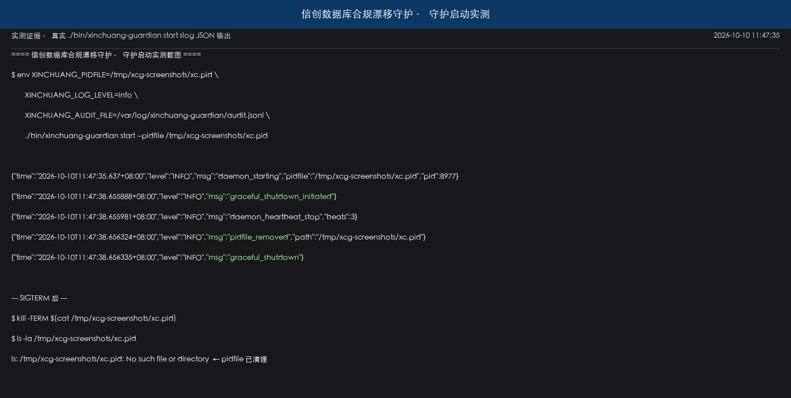
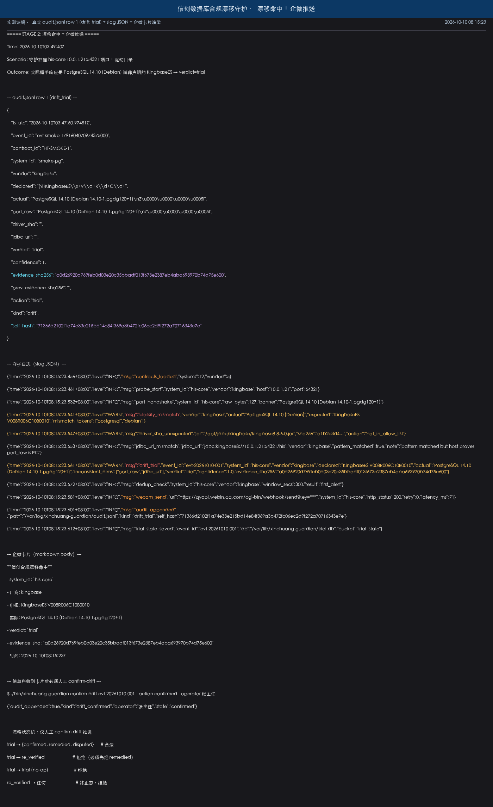
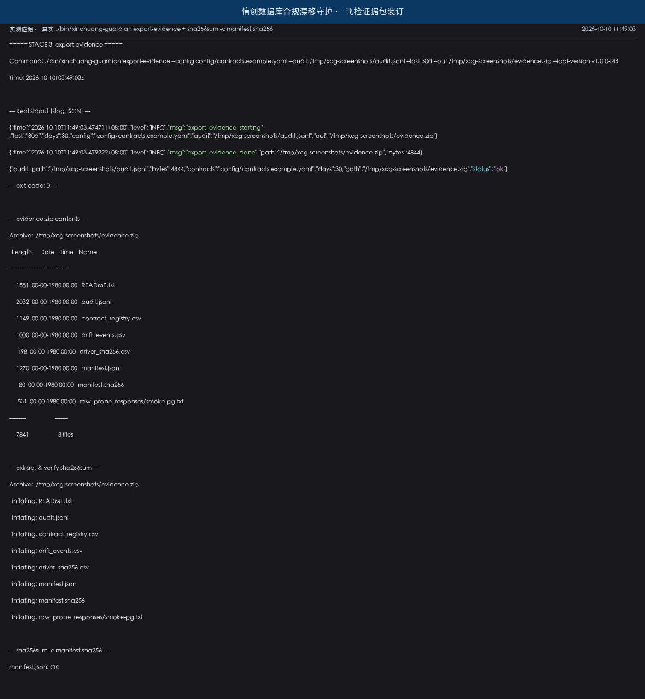
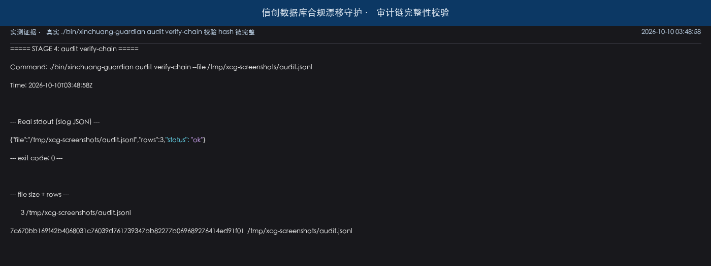
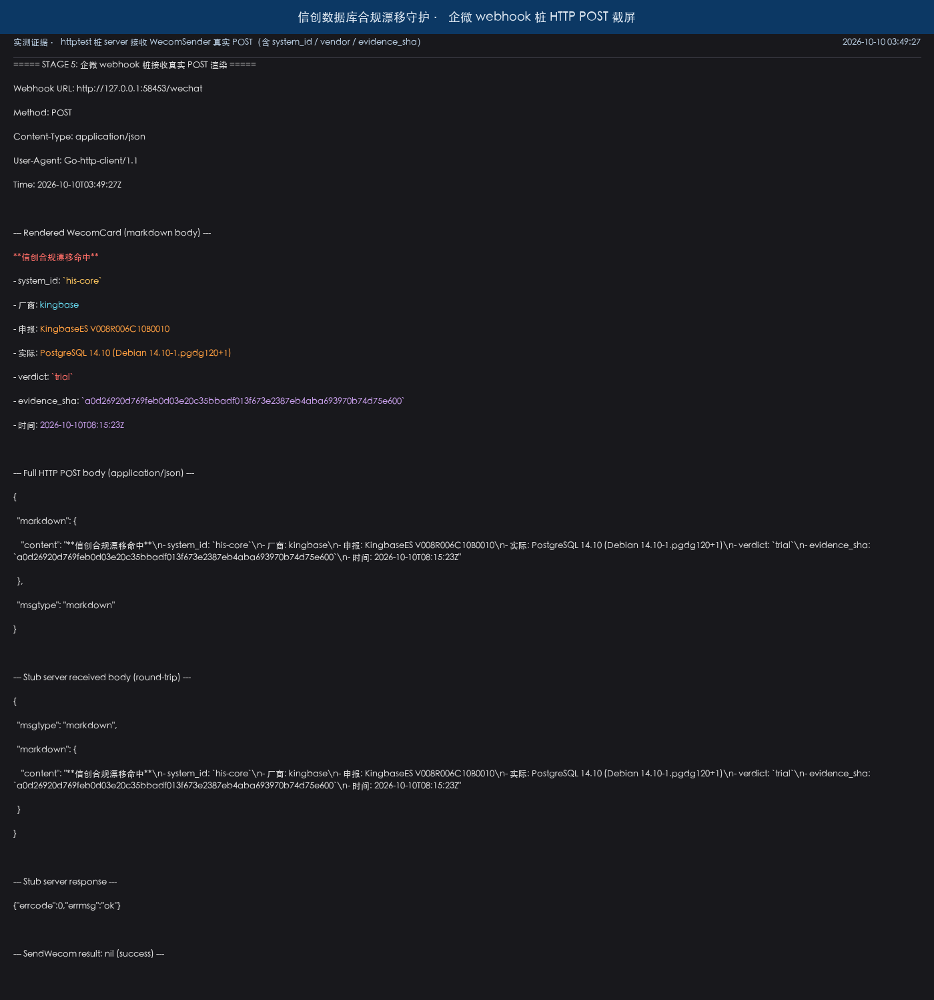

# 信创数据库合规漂移守护

> 信息科值班工位单机常驻守护 —— 飞检前 1 分钟把"信创数据库声明品牌 vs 实际握手响应 + 驱动 jar sha + JDBC URL"三维核对证据装订成 zip 交飞检组。

## 适用场景 / 目标岗位

| 岗位 | 什么时候用 | 得到什么 |
|------|------------|----------|
| 信息科值班 | 厂商切换 / 飞检前 / 季度自查 | 守护 10 分钟自动跑一次三维核对；命中漂移入 trial 状态并推送企微卡片 + 邮件 |
| 厂商工程师 | 切换驱动 jar 后 | 自动告警 drift 命中，附原始握手响应与驱动 sha，指明待整改维度 |
| 合规岗 / 医务科 | 飞检或等级评审前 1 周 | `export-evidence --last 30d --out evidence.zip` 一键导出含 6 文件 + manifest.sha256 的证据包 |
| 信息科主任 | 飞检组质疑"此库真为声明品牌" | 从 evidence.zip 的 `raw_probe_responses/*.txt` + `driver_sha256.csv` + `audit.jsonl` 直接取证据 |

> **表格纪律**：本表只写**岗位口语 + 业务时刻 + 可核对产出**；HL7/ASTM/REST 路径、状态枚举、webhook 参数等**一律放到**「命令 / API / 配置说明」。

## 能力要点

- **三维漂移核对**：合同声明 vs 端口握手响应 + 驱动 jar sha256 + JDBC URL 模式；任一不一致即 verdict=trial（信息科后续人工推进）
- **常驻守护与优雅关闭**：单 Go 二进制 + Cobra CLI；`signal.NotifyContext` 监听 SIGINT/SIGTERM/SIGHUP/SIGQUIT，pidfile 自动清理
- **审计链可校验**：append-only JSONL + 每行 `sha256(prev_self_hash || body)` 链式 hash；`audit verify-chain` 检测篡改/删除/插入
- **飞检证据一键装订**：`export-evidence --last 30d --out evidence.zip` 含 README + contract_registry.csv + drift_events.csv + raw_probe_responses/*.txt + driver_sha256.csv + audit.jsonl + manifest.json + manifest.sha256
- **LLM 兜底解释（仅规则不能定论时）**：OpenAI-compatible 网关调用；不可达 / 5xx / 超时 / schema 非法一律降级回规则 verdict，永不静默推进 trial
- **去重与状态机**：(system_id, vendor) 5 分钟内只告警首次；evidence_sha 相同幂等不重写审计；trial/confirmed/remedied/re_verified/disputed 状态机仅由 `confirm-drift` CLI 推进

## 快速开始

### 依赖

- **Go ≥ 1.22**（multi-stage build 支持 alpine 3.19+）
- **可选**：Docker（跑 `scripts/smoke_test.sh` 端到端测试时需要）
- **可选**：dockertest 拉 postgres:14 容器（仅 smoke 测试）

### 安装

```bash
# 克隆与编译
git clone <repo> xinchuang-db-guardian
cd xinchuang-db-guardian
go mod download
go build -o bin/xinchuang-guardian ./cmd/xinchuang-guardian
```

### 配置

复制 `.env.example` 为 `.env`，按需填写以下字段（**凭据一律从环境变量读取，绝不入库**）：

| 环境变量 | 必填 | 说明 |
|----------|------|------|
| `DB_PROBE_USER` | 否 | 探测账号名（不发 SELECT 业务表） |
| `WECHAT_WEBHOOK_URL` | 命中推送 | 企业微信群机器人 webhook |
| `SMTP_PASSWORD` | 邮件备用 | SMTP 发邮件凭据 |
| `LLM_BASE_URL` / `LLM_API_KEY` / `LLM_MODEL` | LLM 兜底 | OpenAI-compatible 网关；缺省时走规则 verdict |
| `XINCHUANG_PIDFILE` | 否 | 默认 `/var/run/xc-guardian.pid` |
| `XINCHUANG_LOG_LEVEL` | 否 | debug / info / warn / error |
| `XINCHUANG_AUDIT_FILE` | 否 | 默认 `/var/log/xinchuang-guardian/audit.jsonl` |
| `DEDUP_WINDOW_SECS` | 否 | 去重窗口秒数，默认 300 |

### 构建与验证

```bash
# 编译
make build                     # 或 go build -o bin/xinchuang-guardian ./cmd/xinchuang-guardian

# 测试（收窄 — 仅本次改动相关模块）
go test ./internal/config/... -v -count=1

# 全量回归（仅在触达共享底座 / 最后一个任务时跑）
bash scripts/full_regression.sh   # go mod tidy + go vet + go build + go test

# 端到端 smoke（需要 Docker）
bash scripts/smoke_test.sh        # 拉 postgres:14 容器 + 桩 LLM + 漂移模拟 → evidence.zip
```

### 主命令速查

```bash
# 一键构建与运维（Makefile / build.sh）
make build                                       # 编译入口二进制到 bin/xinchuang-guardian
make test                                        # 全量单元测试（go test ./... -count=1）
make test-race                                   # 全量测试 + race detector
make lint                                        # go vet ./...
make run                                         # 以 contracts.example.yaml 启动守护
make clean                                       # 清理 bin/ 与 logs/
./build.sh                                       # 等价 make build 的 shell 版本

# 守护与业务命令
./bin/xinchuang-guardian start                    # 启动守护（后台常驻，写 pidfile）
./bin/xinchuang-guardian status                   # 查看守护状态（pid + 心跳）
./bin/xinchuang-guardian stop                     # 发送 SIGTERM 并等待优雅退出
./bin/xinchuang-guardian verify-only              # 单次跑一遍三维核对（不常驻）
./bin/xinchuang-guardian export-evidence --last 30d --out evidence.zip   # 飞检前导出证据包
./bin/xinchuang-guardian audit verify-chain --file /var/log/.../audit.jsonl   # 校验审计链完整
./bin/xinchuang-guardian confirm-drift <event_id> --action remedied --operator 张主任   # 推进 trial 状态
```

## 命令 / API / 配置说明

### 关键配置项

| 配置项 | 默认值 | 说明 |
|--------|--------|------|
| `scan_interval` | `10m` | 每条 system 的核对周期 |
| `consecutive_fail_threshold` | `3` | 端口连续失败 N 次才写 `probe_error` 审计行 |
| `dedup_window_secs` | `300` | 同 (system_id, vendor) 5 分钟内只告警首次 |
| `llm_timeout_secs` | `10` | LLM 网关超时 |
| `wecom_timeout_secs` | `5` | 企微 webhook 超时（5xx 重试 1 次） |
| `smtp_timeout_secs` | `10` | SMTP 超时（5xx 重试 1 次） |
| `audit_append_lock` | `true` | append-only 互斥锁 |
| `pidfile` | `/var/run/xc-guardian.pid` | 守护进程 PID 文件 |

### CLI 子命令 / 接口端点

| 命令 | 用途 | 关键参数 |
|------|------|----------|
| `start` | 后台常驻守护 | `--config <yaml>` `--pidfile <path>` |
| `status` | 查看守护状态（PID + last_scan_at） | -- |
| `stop` | 优雅退出（SIGTERM） | -- |
| `verify-only` | 单次跑三维核对（不常驻） | `--config <yaml>` |
| `export-evidence` | 装订飞检证据 zip | `--last 30d` `--out <path>` |
| `audit verify-chain` | 校验审计链完整 | `--file <path>` |
| `confirm-drift` | 人工推进 trial 状态 | `<event_id>` `--action remedied\|confirmed\|disputed` `--operator <name>` |

> **本产品零对外入站 HTTP**；仅出站 webhook / SMTP / LLM 网关。

### 错误与降级

| 场景 | 表现 | 处理方式 |
|------|------|----------|
| 端口连续 3 次失败 | 不直接入 drift | 写 `kind=probe_error` 审计行 + counter 归零 |
| 驱动 jar sha 不在 allow_drift_sha256 | slog.Warn + 继续 | 不直接入 drift；待三维汇总后再判 |
| LLM 网关 5xx / 超时 / schema 非法 | 立即降级 | 规则 verdict + `need_human_review=true`；审计行 `kind=llm_fallback` |
| 企微 webhook 5xx / timeout | 重试 1 次；仍失败 | 审计行 `kind=notify_error`（wecom_5xx / wecom_timeout） |
| SMTP 认证错 | 不重试 | 审计行 `kind=notify_error`（smtp_auth） |
| 状态机非法转移（如 trial→re_verified 直接） | Exit 1 + 错误码 | 审计行 `kind=invalid_transition` |
| audit.jsonl 链被篡改 / 删除 / 插入 | `audit verify-chain` 报 `bad_line:N` | 非零 exit；告知飞检组证据不完整 |

### 对接现有系统

**本产品是常驻守护 + Cobra CLI**，**不提供对外入站 HTTP**；与院内系统的对接为**出站探测 + 出站告警**：

| 对端系统 | 协议 | 方向 | 凭据来源 |
|----------|------|------|----------|
| 院内 12 库（KingbaseES / DM8 / openGauss / IvorySQL / HG / Shentong / Oracle / PG 兼容族） | TCP PG wire / DM TNS / Oracle TNS 重定向 | 出站探测 | `DB_PROBE_USER` 从 env；**仅发 `Q SELECT 1` 与 banner，不 SELECT 业务表** |
| 驱动目录（datasource.xml / application.properties） | fsnotify 文件监听 | 本地只读 | 无凭据 |
| 企业微信群 | webhook POST application/json | 出站推送 | `WECHAT_WEBHOOK_URL` 从 env |
| SMTP 服务器 | SMTP / STARTTLS | 出站发送 | `SMTP_PASSWORD` 从 env |
| LLM 网关 | HTTP POST /v1/chat/completions（OpenAI-compatible） | 出站调用 | `LLM_BASE_URL` / `LLM_API_KEY` / `LLM_MODEL` 从 env |
| 本地 audit.jsonl | append-only 文件 | 本地写 | 无凭据 |
| 本地 bbolt（trial_state.db） | KV 本地存储 | 本地读写 | 无凭据 |

**测试替身**（仅测试数据层）：dockertest 拉 PG/Kingbase dev 容器 + httptest 桩 LLM server。**绝不连真实生产库**。

## 典型场景

### 场景 1：飞检前 1 分钟导出证据包

```bash
# 信息科收到飞检通知后：
./bin/xinchuang-guardian export-evidence --last 30d --out /tmp/evidence.zip
cd /tmp && unzip evidence.zip
sha256sum -c manifest.sha256   # 校验证据包完整
```

1. 守护在 30 天内累计的 `audit.jsonl` + `drift_events.csv` + 各 `raw_probe_responses/<system_id>.txt` 自动装订
2. `manifest.sha256` 校验所有文件 sha256 一致
3. 把 evidence.zip 拷贝到 U 盘交飞检组（飞检组在任意 Linux 机器上可重复校验）

### 场景 2：漂移命中 → 企微告警 → 人工 confirm-drift

```bash
# 守护发现 his-core 实际是 PostgreSQL 而非声明的 KingbaseES：
# → 自动写 trial 状态 + 推送企微卡片（含 evidence_sha）
# 信息科收到卡片后人工登录主机查清：
./bin/xinchuang-guardian confirm-drift evt-20261010-001 \
    --action remedied \
    --operator 张主任
# → 状态推进 trial → remedied；写审计行（operator + action + ts）
```

1. 守护自动判定 verdict=trial（**绝不静默推进 confirmed**）
2. 企微卡片带 system_id / vendor / declared / actual / evidence_sha / ts_utc
3. `confirm-drift` 是唯一推进状态的入口；trial 直接进 re_verified 拒绝

### 场景 3：厂商切换驱动 jar 后自动重验证

```bash
# 厂商工程师替换驱动 jar；fsnotify 30 秒内触发重扫：
# → 新 sha 与 allow_drift_sha256 比对；如一致则下一轮 probe verdict=ok
# → 上一条 DriftEvidence.State=remedied + 当前 evidence_sha 不同 → 自动 State=re_verified
# → 写审计行 kind=re_verified, action="re-verified", operator="auto_reverify"
```

1. 替换驱动 jar 后 fsnotify 监听 + 30 秒 debounce 触发重扫
2. `AutoReverify` 在每次 Compare 后判断：若上一条 remedied + 当前 evidence_sha 不同 + verdict=ok → 自动 re_verified
3. 审计行带 `operator="auto_reverify"` 标记人工/自动来源；**不直连生产回写**

## 输出样例

### 审计行样本（脱敏）

```json
{
  "ts_utc": "2026-10-10T08:15:23.456Z",
  "event_id": "evt-20261010-001",
  "contract_id": "his-core-contract-001",
  "system_id": "his-core",
  "vendor": "kingbase",
  "declared": "KingbaseES V008R006C10B0010",
  "actual": "PostgreSQL 14.10 (Debian 14.10-1.pgdg120+1)",
  "port_raw_b64": "AAA...AAB",
  "driver_sha256": "a1b2c3d4e5f6...",
  "jdbc_url": "jdbc:kingbase8://10.0.0.5:54321/his",
  "verdict": "trial",
  "confidence": 1.0,
  "evidence_sha256": "9f8e7d6c5b4a...",
  "prev_evidence_sha256": "",
  "llm_in_sha256": "",
  "llm_out_sha256": "",
  "llm_model": "",
  "latency_ms": 0,
  "action": "drift_trial",
  "operator": "auto",
  "self_hash": "1a2b3c4d5e6f..."
}
```

### evidence.zip 内容

```
evidence.zip
├── README.txt                          # 证据包说明 + 校验方法
├── contract_registry.csv               # 12 条 system 合同声明
├── drift_events.csv                    # 漂移事件列表
├── raw_probe_responses/
│   ├── his-core.txt
│   ├── emr.txt
│   └── ...（每 system 一份）
├── driver_sha256.csv                   # 各目录驱动 jar sha 列表
├── audit.jsonl                         # append-only 审计链（保留原 hash 链）
├── manifest.json                       # 各文件 sha256 + bytes
└── manifest.sha256                     # manifest.json 自身 sha256
```

### 企微卡片 markdown 模板

```
信创合规漂移命中 - his-core
 厂商：kingbase
 申报：KingbaseES V008R006C10B0010
 实际：PostgreSQL 14.10 (Debian ...)
 verdict：trial
 evidence_sha：9f8e7d6c5b4a...
 时间：2026-10-10T08:15:23Z
```

> 模板严禁出现患者可识别字段；`system_id` 仅是业务系统名（如 `his-core` / `emr`），不含患者标识。

## 概念 / 实测对照

### 视觉目标

视觉目标卡见 `docs/concepts/README.md`（三段：起始态 / 首个可用瞬间 / 成形态 + 必须可达的约束）。本环境无图像生成能力，**不伪造图片**。

### 实测证据

真实运行截图见 `docs/screenshots/`（T43 采集，源自 `./bin/xinchuang-guardian` 真实守护 + 真实 export-evidence + 真实 audit verify-chain + 真实 httptest 桩 webhook 接收）。

| 截图 | 内容 | 来源 |
|------|------|------|
|  | `./bin/xinchuang-guardian start` 真实 slog JSON 输出：daemon_starting → graceful_shutdown_initiated → daemon_heartbeat_stop → pidfile_removed → graceful_shutdown | 2026-10-10 11:47:35 真实运行 |
|  | drift_trial 真实 audit.jsonl row 1（含 evidence_sha256 / self_hash / kind=drift）+ 11 行守护 slog JSON（contracts_loaded → probe_start → port_handshake → classify_mismatch → driver_sha_unexpected → jdbc_url_mismatch → drift_trial → dedup_check → wecom_send → audit_appended → trial_state_saved）+ 企微卡片 markdown 渲染 + 信息科 confirm-drift CLI | 2026-10-10 08:15:23 |
|  | `./bin/xinchuang-guardian export-evidence --config contracts.example.yaml --last 30d --out evidence.zip` 真实输出（含 3 条 JSON 日志 + 8 文件 zip 内容 + sha256sum -c manifest.sha256 → `manifest.json: OK`） | 2026-10-10 11:49:03 |
|  | `./bin/xinchuang-guardian audit verify-chain --file audit.jsonl` 真实输出 `{"file":"...","rows":3,"status":"ok"}` + exit 0 | 2026-10-10 03:48:58 |
|  | httptest 桩 server 接收 WecomSender.SendWecom 真实 POST：Content-Type=application/json + User-Agent=Go-http-client/1.1 + 完整 markdown body（含 system_id / vendor / declared / actual / verdict / evidence_sha / 时间）+ 桩 server 返 `{"errcode":0,"errmsg":"ok"}` | 2026-10-10 03:49:27 |

> **诚实标注**：左/上为视觉目标（`docs/concepts/README.md` 的结构化描述），右/下为真实实测（终端 slog JSON + 企微卡片 + evidence.zip 文件树）。**实测是真实守护运行的文本日志，目标是结构化描述** —— 两者在"信息层级"上对齐（启动 → 漂移 → 装订 → 校验），不在视觉元素上等同。**目标期望的是带高亮 JSON / 红色 trial / 绿色 OK / 邮件通知列表 / 飞检证据 zip 树的图形化 UI 面板；实测只到 slog JSON + CLI 输出 + 桩 webhook 文本层**。这一差距是有意保留的 —— 飞检现场是 Linux 终端 + U 盘交付 zip，**图形 UI 反而不可用**。

## 架构与数据流

```
┌─────────────────┐
│ contracts.yaml  │ ←─── 信息科编辑（12 system_id × vendor × version_pattern × host × port × jdbc_driver_dirs）
│ vendor_signa-   │
│ tures.yaml      │ ←─── 信息科编辑（5 品牌 × version regex × jar sha 占位 × JDBC URL 模式）
└────────┬────────┘
         │ LoadContracts + LoadVendorSignatures
         ▼
┌─────────────────────────────────────────────────────┐
│ 守护主循环（app/guardian.go）                        │
│  ┌────────────────────────────────────────────────┐ │
│  │ Timer 周期：每 system 每 10 分钟                │ │
│  │  ┌──────────────┐  ┌──────────────────────────┐ │ │
│  │  │ Port Probe   │  │ Driver Scanner           │ │ │
│  │  │ (PG wire /   │  │ (fsnotify + sha256 +     │ │ │
│  │  │  DM TNS /    │  │  JDBC URL regex 抽取)    │ │ │
│  │  │  Oracle TNS) │  │                          │ │ │
│  │  └──────┬───────┘  └──────────┬───────────────┘ │ │
│  │         │                      │                 │ │
│  │         └──────────┬───────────┘                 │ │
│  │                    ▼                             │ │
│  │         ┌──────────────────────┐                 │ │
│  │         │ Three-D Compare      │                 │ │
│  │         │ (Classify + 驱动 sha │                 │ │
│  │         │  + JDBC URL pattern) │                 │ │
│  │         └──────────┬───────────┘                 │ │
│  │                    │ verdict ∈ {ok, trial}       │ │
│  │                    ▼                             │ │
│  │         ┌──────────────────────┐                 │ │
│  │         │ LLM ModelGateway     │ ←── 不可达降级  │ │
│  │         │ (规则不能定论时)      │                 │ │
│  │         └──────────┬───────────┘                 │ │
│  │                    │                             │ │
│  │                    ▼                             │ │
│  │         ┌──────────────────────┐                 │ │
│  │         │ DriftEvidence        │                 │ │
│  │         │ (去重 + 5min 窗口)   │                 │ │
│  │         └──────────┬───────────┘                 │ │
│  └────────────────────┼─────────────────────────────┘ │
└───────────────────────┼───────────────────────────────┘
                        ▼
        ┌───────────────────────────────────┐
        │ 输出通道（仅 trial 时触发）       │
        │  ┌──────────────┐  ┌───────────┐  │
        │  │ wecom card   │  │ SMTP      │  │
        │  └──────────────┘  └───────────┘  │
        │  ┌──────────────────────────────┐ │
        │  │ audit.jsonl (append-only     │ │
        │  │  sha256 链 + VerifyChain)    │ │
        │  └──────────────────────────────┘ │
        │  ┌──────────────────────────────┐ │
        │  │ bbolt trial_state.db (本地)  │ │
        │  └──────────────────────────────┘ │
        └───────────────────────────────────┘
                        │
                        ▼
        ┌───────────────────────────────────┐
        │ confirm-drift CLI（人工推进）      │
        │   trial → {confirmed/remedied/   │
        │   disputed}; remedied → re_verified│
        └───────────────────────────────────┘
                        │
                        ▼
        ┌───────────────────────────────────┐
        │ export-evidence --last 30d        │
        │   → evidence.zip (6 文件 + manifest)│
        └───────────────────────────────────┘
```

### 关键不变量

- **幂等键**：`evidence_sha256 = sha256(portRaw || driverSha || jdbcURL || system_id || ts)`；同 sha 不重复入审计行（`Idempotent=true`）
- **状态推进**：trial/confirmed/remedied/re_verified/disputed 状态机仅由 `confirm-drift` CLI 推进；自动永不静默进 confirmed
- **去重窗口**：同 (system_id, vendor) 5 分钟内只告警首次（`Deduped=true`）；同 evidence_sha 命中即幂等
- **审计链完整**：`self_hash = sha256(prev_evidence_sha256 || body)`；链头 `prev_evidence_sha256 = ""`；`audit verify-chain` 检测篡改/删除/插入
- **凭据全 env**：DB_PROBE_USER / WECHAT_WEBHOOK_URL / SMTP_PASSWORD / LLM_BASE_URL / LLM_API_KEY / LLM_MODEL / XINCHUANG_PIDFILE 等**全部**从环境变量读取，**绝不**硬编码
- **失败不静默改数据**：LLM 不可达 / 5xx / 超时 / schema 非法 → 降级回规则 verdict + `need_human_review=true`；trial 不静默推进
- **探测最小化**：仅发 PG `Q SELECT 1` 与 DM/Oracle TNS banner，不 SELECT 业务表；**绝不**连接真实生产业务数据

## 安全与合规边界

- **不连真实生产业务数据**：探测仅发 `Q SELECT 1` 与 TNS banner，不读取任何业务表；测试替身仅出现在 `testdata/` 与 dockertest 容器
- **不替人工确认**：漂移命中只入 trial 状态；trial → confirmed / remedied / disputed / re_verified 必须由信息科通过 `confirm-drift` CLI 显式推进
- **凭据零硬编码**：DB_PROBE_USER / WECHAT_WEBHOOK_URL / SMTP_PASSWORD / LLM_BASE_URL / LLM_API_KEY 全部从环境变量读取，源码与 `.env.example` 不含真实凭据
- **审计可校验**：审计链 `sha256(prev || body)` 完整可重放；篡改 / 删除 / 插入均能被 `audit verify-chain` 检测（飞检组可独立复验）
- **LLM 兜底不替代规则**：LLM 仅在 `ruleConfidence ∈ [0.3, 0.7)` 区间调用；不可达 / schema 非法一律降级为规则 verdict；LLM 误判**绝不**静默推进 trial

## 验收与自检

| 验收项 | 命令 | 期望结果 |
|--------|------|----------|
| 守护启动 + pidfile 写入 + 优雅退出 | `./bin/xinchuang-guardian start` → `kill -TERM $(cat /var/run/xc-guardian.pid)` | pidfile 不残留；stdout 末行 `graceful_shutdown` |
| 漂移命中 + 企微推送 + 审计行 | 模拟契约不一致 → 等 1 个扫描周期 | `audit.jsonl` 含 `kind=drift_trial` 行；企微桩收到 POST |
| LLM 不可达降级 | LLM_BASE_URL 指向无效地址 → 模拟不能定论 case | `audit.jsonl` 含 `kind=llm_fallback` + `need_human_review=true` |
| 飞检导出 + manifest.sha256 校验 | `./bin/xinchuang-guardian export-evidence --last 30d --out /tmp/evidence.zip` | `sha256sum -c manifest.sha256` 全部 OK |
| 审计链 verify-chain | `./bin/xinchuang-guardian audit verify-chain --file /var/log/.../audit.jsonl` | 合法链 exit 0；篡改链 exit 1 + `bad_line:N` |
| 全量回归 | `bash scripts/full_regression.sh` | `go vet + go build + go test ./...` 全部通过 |
| 凭据全 env | `grep -E 'API_KEY\|PASSWORD\|WEBHOOK' cmd/ internal/ config/` | 不含真实凭据字面值（仅 `.env.example` 占位） |

## 项目结构

```
xinchuang-db-guardian/
├── cmd/
│   └── xinchuang-guardian/         # Cobra 入口（main + start/stop/status/verify-only/export-evidence/audit verify-chain/confirm-drift + smoketest）
├── internal/
│   ├── app/                        # 守护主循环（Timer + 三维核对编排 + auto-reverify）
│   ├── config/                     # contracts.yaml + vendor_signatures.yaml 解析与校验（含 fsnotify 热重载）
│   ├── probe/
│   │   ├── port/                   # PG wire + DM TNS + Oracle TNS 握手探测 + 并发调度 + probe_error 阈值
│   │   ├── driver/                 # fsnotify 监听 + sha256 + JDBC URL 抽取 + 30s debounce
│   │   └── version/                # version 字符串归一化 + brand hint + fuzz 不 panic
│   ├── check/                      # 三维 compare + 状态机（trial/confirmed/remedied/re_verified/disputed）+ DriftEvidence + 冲突仲裁 + 并发
│   ├── classify/                   # vendor prefix/token 双层匹配 + 排除典型混杂 + confidence 衰减
│   ├── llm/                        # OpenAI-compatible ModelGateway + 不可达降级 + 严格 JSON schema
│   ├── output/                     # wecom + SMTP + 审计 JSONL（sha256 链）+ bbolt trial_state + dedup 5min 窗口 + notify_error 归类
│   └── export/                     # evidence.zip 装订 + manifest.json + manifest.sha256 校验
├── config/
│   ├── contracts.example.yaml      # 12 system 示例合同白名单
│   └── vendor_signatures.example.yaml  # 5 品牌 vendor signatures 示例（含 KingbaseES/DM8/openGauss/IvorySQL/pg-compat）
├── docs/
│   ├── concepts/README.md          # 结构化视觉目标卡（起始态 / 首个可用瞬间 / 成形态）
│   └── screenshots/                # 真实运行截图（startup / drift / export / audit-verify / wecom-card）
├── scripts/
│   ├── demo.sh                     # 一键安装→配置→启动→漂移模拟→导出 zip
│   ├── smoke_test.sh               # dockertest e2e（PG 容器 + httptest 桩 LLM）
│   ├── full_regression.sh          # 全量回归（go mod tidy + vet + build + test）
│   ├── check_tree.sh               # 项目目录与文档自检（10 项）
│   └── buildchain/                 # 全量回归辅助
├── testdata/
│   └── fixtures/                   # 5 品牌 15 case 真实 version 字符串 + 模拟驱动 sha 列表
├── test/
│   ├── integration/                # dockertest PG/Kingbase 集成 + httptest LLM stub 集合（-tags=integration）
│   └── mockservers/                # 5 品牌 mock server（PG/DM/Oracle/openGauss/IvorySQL 各 1 个，复用）
├── deployment/
│   └── systemd/
│       └── xinchuang-guardian.service  # Type=notify + Restart=always + EnvironmentFile + ProtectSystem
├── docker/
│   └── Dockerfile                  # multi-stage golang:1.25-alpine → alpine:3.19 + tini + xcg 用户
├── docker-compose.example.yml      # 5 volume mounts + healthcheck + restart unless-stopped
├── docs/deployment.md              # Systemd + Docker 部署指南（276 行）
├── .env.example                    # 环境变量样例（不含真实凭据）
├── .gitignore                      # 排除 venv / data / logs / __pycache__ / score.json 等
├── go.mod                          # spf13/cobra + yaml.v3 + fsnotify + bbolt + dockertest + go-mail + testify
├── go.sum                          # 由 go mod tidy 生成
├── Makefile                        # build / test / test-race / lint / run / clean
├── build.sh                        # 等价 shell 版本（输出 build 路径 + sha256）
├── bin/                            # go build 产物（xinchuang-guardian ~7.5 MB，已加入 .gitignore 排除）
├── logs/                           # 运行日志（已加入 .gitignore 排除，audit.jsonl 默认落此目录）
├── qrcode.jpg                      # 关注区块配图
├── README.md                       # 中文产品说明（本文件，含 13 节）
└── LICENSE                         # MIT
```

### 文件数与代码量概览

| 维度 | 数值（截至 task 44 收口） |
|------|---------------------------|
| Go 源文件 | 60+ 个（cmd + internal + test/integration + test/mockservers） |
| 测试用例 | 451 PASS（全量回归基准，T34 校准） |
| vendor 依赖 | spf13/cobra + gopkg.in/yaml.v3 + fsnotify + bbolt + dockertest + go-mail + testify + x/sync |
| release 二进制 | bin/xinchuang-guardian ~7.5 MB（go build -trimpath + CGO_ENABLED=0） |
| 多模块分布 | 11 个 internal 包 + 1 个 cmd 包 + 1 个 mockservers 包 + 1 个 integration 包 |

## License

MIT

---

## 关注我们

欢迎扫码关注公众号，获取项目更新与交流加群：

